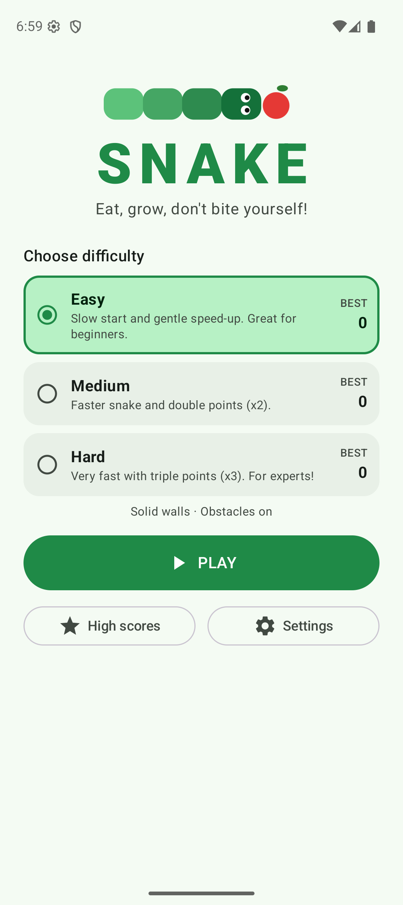
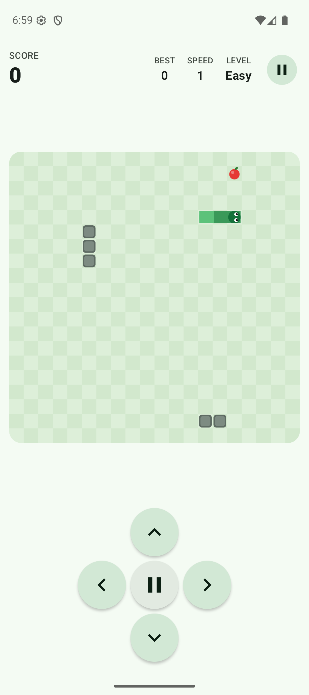
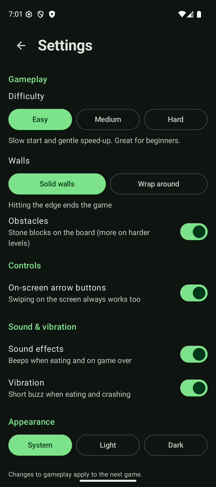

# 🐍 Snake — Android Game

A modern Snake game for Android phones and tablets, written in **Kotlin** with **Jetpack Compose**.
Eat apples, grow longer, chase golden bonus stars and try not to bite yourself!

<p>
  
  
  
</p>

---

## ✨ Features

| Feature | Details |
|---|---|
| **3 difficulty levels** | **Easy** (slow, for beginners) · **Medium** (faster, points ×2) · **Hard** (very fast, points ×3) |
| **Speed increases** | The snake gets faster every time it eats (speed 1 → 10) |
| **Two wall modes** | **Solid walls** (hit the edge = game over) or **Wrap around** (come out the other side) |
| **Two control styles** | **Swipe** anywhere on the screen **and** on-screen **arrow buttons** (can be hidden) |
| **Keyboard support** | Arrow keys / W A S D to move, Space / P to pause (handy on the emulator) |
| **Obstacles** | Stone blocks on the board (more on harder levels), can be turned off |
| **Bonus food** | A golden star appears after every 5 apples, worth 50 points, but it disappears quickly! |
| **High scores** | Best score for each difficulty is saved on the device |
| **Pause / resume** | Pause button, back button, or automatically when you leave the app |
| **Sound effects** | Retro sounds generated in code (no audio files needed) |
| **Vibration** | Short buzz when eating and when crashing |
| **Light / Dark theme** | Follow the phone setting, or choose Light or Dark |
| **Portrait & landscape** | Works in both orientations; the game keeps going when you rotate |
| **Custom app icon** | A coiled snake with an apple (adaptive icon) |

---

## 🧰 Technology used

| Part | Technology |
|---|---|
| Language | **Kotlin** |
| User interface | **Jetpack Compose** + **Material 3** |
| Game drawing | Compose **Canvas** |
| Game loop | **Kotlin Coroutines** |
| Architecture | **MVVM** (ViewModel + StateFlow) |
| Saving settings & high scores | **Jetpack DataStore** |
| Build system | **Gradle** (Kotlin DSL) with a version catalog |
| Tests | **JUnit** unit tests for all game rules |
| Android versions | Android **7.0 (API 24)** and newer · compiled against API 36 |

---

## 🚀 Setup: step by step

### Step 1: Install the tools (one time only)

1. Install **Android Studio** (free): https://developer.android.com/studio
   *(Already installed? Skip this.)*
2. Install **Git**: https://git-scm.com/downloads
3. Open Android Studio once and finish the **Setup Wizard** (choose "Standard"). This installs the Android SDK.

> You do **not** need to install Java separately. Android Studio comes with its own Java (JDK 21).

### Step 2: Download the project

**Option A: from inside Android Studio (easiest)**

1. Open Android Studio.
2. On the welcome screen click **Clone Repository** (or menu **File → New → Project from Version Control…**).
3. Paste this URL: `https://github.com/zameerahma/snakeapp.git`
4. Choose a folder, then click **Clone**.
5. When asked "Trust and open project?", click **Trust Project**.

**Option B: with the command line**

```bash
git clone https://github.com/zameerahma/snakeapp.git
```

Then in Android Studio: **File → Open…** and select the `snakeapp` folder.

### Step 3: Wait for Gradle sync

The first time you open the project, Android Studio downloads everything it needs (Gradle, libraries).
Look at the bottom status bar: wait until it says **"Gradle sync finished"**. This can take **2 to 10 minutes** the first time and needs an internet connection.

> If Android Studio asks to install a missing **SDK Platform** or **Build-Tools**, click the blue **Install** link and accept.

### Step 4: Run the game

**On the emulator (virtual phone):**

1. Menu **Tools → Device Manager**.
2. Click **+** → **Create Virtual Device** → pick a phone (e.g. *Pixel 8*) → **Next**.
3. Pick a system image (e.g. the newest **API** with a download icon → download it) → **Next** → **Finish**.
4. At the top toolbar select your virtual device, make sure **app** is selected, then press the green **▶ Run** button.

**On a real Android phone:**

1. On the phone: **Settings → About phone** → tap **Build number** 7 times to unlock *Developer options*.
2. Go to **Settings → System → Developer options** → turn on **USB debugging**.
3. Connect the phone with a USB cable and tap **Allow** on the phone when asked.
4. Select the phone in the Android Studio toolbar and press **▶ Run**.

### Step 5: Share the game as an APK file (optional)

To install the game on other phones without Android Studio:

1. Menu **Build → Build App Bundle(s) / APK(s) → Build APK(s)**.
2. When it finishes, click **locate** in the pop-up.
   The file is `app/build/outputs/apk/debug/app-debug.apk`.
3. Send this file to a phone and open it. (The phone must allow *"Install unknown apps"* for the app you open it with.)

### Getting the latest version later

In Android Studio: menu **Git → Pull…** (or on the command line: `git pull`).

---

## 🎮 How to play

1. Choose **Easy**, **Medium** or **Hard** on the main menu and press **PLAY**.
2. **Swipe** (or press an arrow button) to start and to steer the snake.
3. Eat 🍎 apples to grow and score points. Every 5 apples a ⭐ **golden bonus** appears for a short time.
4. Don't hit your own body or the stone blocks. With **Solid walls** the edges are dangerous too.
5. Press **⏸** to pause. The game also pauses by itself if you leave the app.

| Food | Easy | Medium | Hard |
|---|---|---|---|
| 🍎 Apple | 10 | 20 | 30 |
| ⭐ Bonus star | 50 | 100 | 150 |

---

## 📁 Project structure

```
app/src/main/java/com/zameerahma/snakeapp/
├── MainActivity.kt            ← App entry point
├── SnakeApplication.kt        ← Creates shared objects (settings, sound, vibration)
├── game/
│   ├── GameModels.kt          ← Data: Point, Direction, Difficulty, GameState…
│   └── GameEngine.kt          ← ALL game rules (move, eat, crash, bonus, obstacles)
├── data/
│   └── SettingsRepository.kt  ← Saves settings & high scores (DataStore)
├── audio/
│   ├── SoundPlayer.kt         ← Generates and plays retro sound effects
│   └── Haptics.kt             ← Vibration
└── ui/
    ├── SnakeAppRoot.kt        ← Switches between screens
    ├── GameViewModel.kt       ← Game loop (timer) + events
    ├── SettingsViewModel.kt   ← Settings / high score actions
    ├── theme/Theme.kt         ← Colors (light + dark) and fonts
    ├── components/Common.kt   ← Reusable UI pieces
    ├── menu/MenuScreen.kt     ← Main menu
    ├── game/GameScreen.kt     ← Game screen, swipe & keyboard, pause/game-over
    ├── game/GameBoard.kt      ← Draws the board, snake, apple, star, obstacles
    ├── game/DirectionPad.kt   ← On-screen arrow buttons
    ├── settings/SettingsScreen.kt
    └── scores/HighScoresScreen.kt

app/src/test/java/.../game/GameEngineTest.kt   ← Unit tests for the game rules
app/src/main/res/                              ← App icon, app name, themes
```

### 🧪 Ideas for students: things you can change

| What | Where |
|---|---|
| Snake speed per level | `Difficulty` in `game/GameModels.kt` (`startTickMs`, `minTickMs`, `speedUpPerFoodMs`) |
| Board size (20 × 20) | `GameConfig` in `game/GameModels.kt` |
| Points for apple / bonus | `FOOD_POINTS`, `BONUS_POINTS` in `game/GameEngine.kt` |
| How often the bonus appears | `BONUS_EVERY`, `BONUS_LIFETIME_TICKS` in `game/GameEngine.kt` |
| Snake / board colors | `LightBoard` and `DarkBoard` in `ui/theme/Theme.kt` |
| Sound effect melodies | `notesFor()` in `audio/SoundPlayer.kt` |

---

## ✅ Running the tests

In Android Studio: open `app/src/test/java/com/zameerahma/snakeapp/game/GameEngineTest.kt`
and click the green ▶ next to `class GameEngineTest`.

Or from the terminal in the project folder:

```bash
./gradlew testDebugUnitTest
```

(On Windows Command Prompt use `gradlew testDebugUnitTest`.)

---

## 📦 Publishing to Google Play

1. **Create a signing key (one time).** In Android Studio: **Build → Generate Signed App Bundle / APK… → Android App Bundle → Next → Create new…**
   Save the `.jks` file **outside** the project folder (or in it; `*.jks` is git-ignored) and **keep it and the passwords safe forever**. You need the same key for every update.
2. **Tell Gradle about the key.** Create a file named `keystore.properties` in the project root (it is git-ignored, never commit it):
   ```properties
   storeFile=C:/path/to/snake-release.jks
   storePassword=your-store-password
   keyAlias=snake
   keyPassword=your-key-password
   ```
3. **Build the bundle:** `./gradlew bundleRelease` → the file is `app/build/outputs/bundle/release/app-release.aab`.
   (Or use the **Generate Signed App Bundle** wizard from step 1.)
4. **Google Play Console** (https://play.google.com/console, one-time USD 25 developer fee):
   create the app, upload the `.aab` under *Testing → Internal testing* first, then *Production*.
   You'll also need a 512 × 512 PNG icon, screenshots (see `docs/screenshots/`), a short description and a privacy policy URL.
   The app collects no personal data and uses only the vibration permission.
5. **For every update**, increase `versionCode` (and `versionName`) in `app/build.gradle.kts`.

---

## 🛠️ Troubleshooting

| Problem | Fix |
|---|---|
| **Gradle sync failed** / "could not resolve" | Check the internet connection, then **File → Sync Project with Gradle Files**. |
| **"SDK location not found"** | **File → Project Structure → SDK Location** and pick your Android SDK folder. Android Studio then writes `local.properties` for you. |
| **"Android SDK Platform 36 not installed"** | Click the *Install* link in the error, or **Tools → SDK Manager** → tick **Android 16 (API 36)** → Apply. |
| **Wrong Java / JDK version** | **Settings → Build, Execution, Deployment → Build Tools → Gradle → Gradle JDK** → choose **jbr-21** (Android Studio's built-in Java). |
| **Emulator is very slow or won't start** | In Device Manager, *Wipe Data* or create a new device. On Windows, enable *Windows Hypervisor Platform* in "Turn Windows features on or off". |
| **No sound** | Check the phone's media volume and that *Sound effects* is on in the game's Settings. |
| **Phone not showing in Android Studio** | Re-plug the cable, accept the *Allow USB debugging* prompt on the phone, try another cable/port. |

---

**Package name:** `com.zameerahma.snakeapp` · **Version:** 1.0.0
